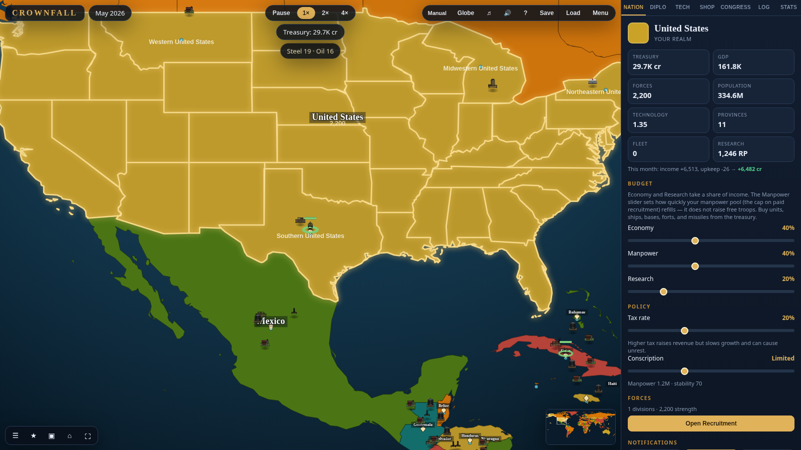
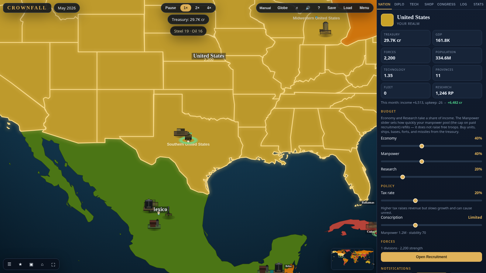
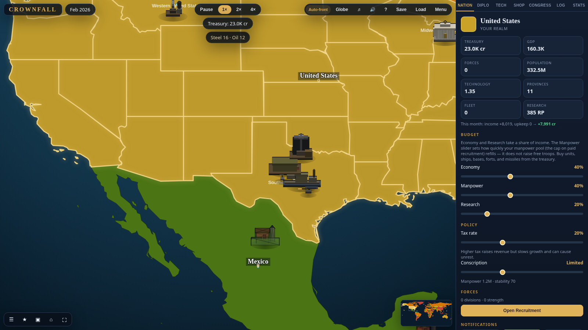
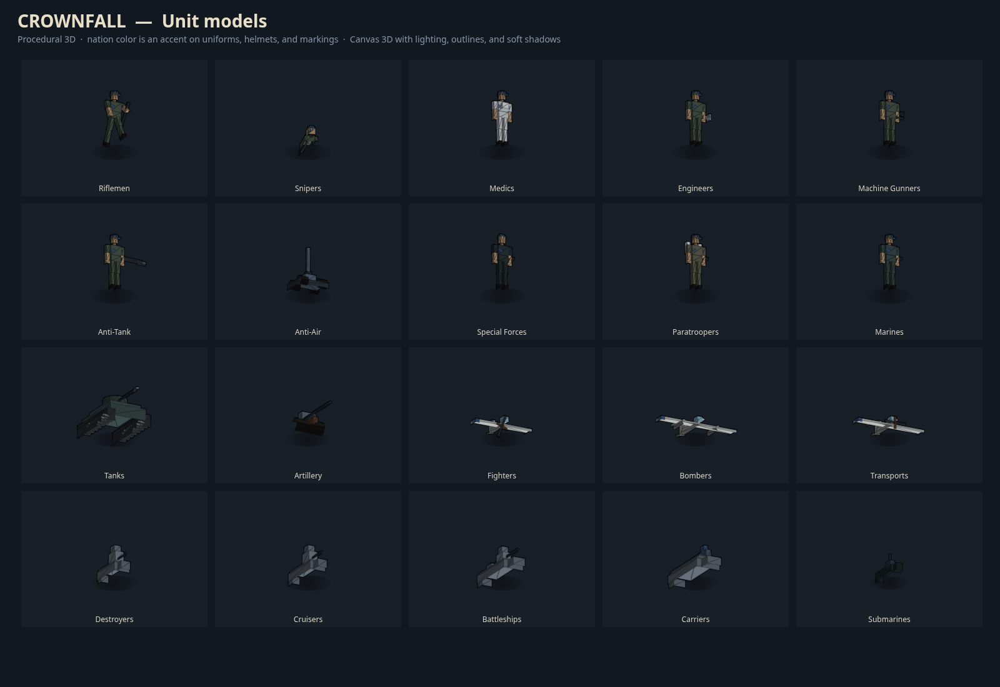
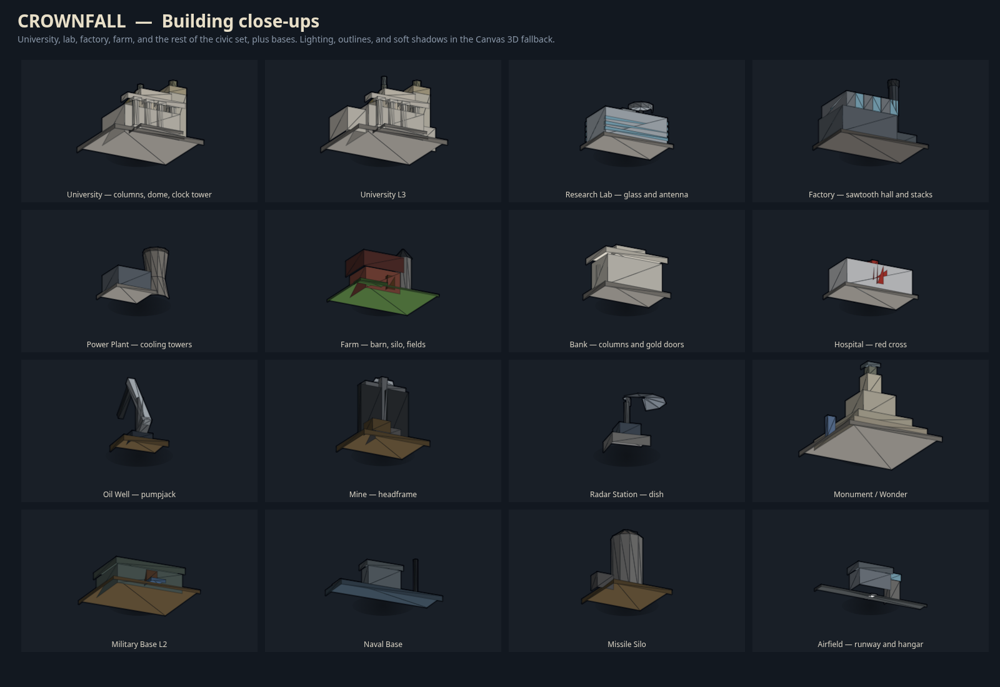

# Crownfall

A real-world grand strategy game that runs in your browser. Pick any country, build bases and cities, buy troops, research tech, and conquer the world on a flat map or a 3D globe.

## Play
- **In your browser (no install):** https://langerweston-web.github.io/crownfall/
- **Windows:** download `Crownfall-Windows.zip` from the [v1.9.1 release](https://github.com/langerweston-web/crownfall/releases/tag/v1.9.1), unzip, and run `Crownfall\Crownfall.exe`. This is a standard Electron app — the game runs inside it, so you do not need Chrome or Edge installed. The app is unsigned, so Windows SmartScreen or your antivirus may warn on first launch. Click **More info → Run anyway**. If you would rather not run the .exe, use the browser version above.
- **Offline:** download `index.html` and open it in any browser.
- **v1.9.1 mirrors:** [HTML](https://files.catbox.moe/8n9oib.html) · [Windows zip](https://files.catbox.moe/5vrvjk.zip)

## Browser compatibility
Crownfall is a web game and runs in Chrome, Edge, Opera, Opera GX, Firefox, and Safari, or as the Windows Electron app. No extra plugin is required.

- **Opera / Opera GX:** if the map feels choppy, open Help (?) and set Performance to Low. Opera GX RAM and CPU limiters can cap the frame rate; Low caps FPS at 30 and lightens effects. If multiplayer cannot connect, allow this site in Opera's Ad blocker and Tracker blocker, and pause Opera VPN. You can still play on the same computer from the Multiplayer menu.
- **Sound:** the first click or key press unlocks audio (browsers block sound until then).
- **Full screen:** use the Full button in the top bar, or the browser's F11.
- **No install:** use the browser link above, or download `index.html` and open it locally.

## What's new in v1.9.1
- The Windows package is now a standard [Electron](https://www.electronjs.org/) app. The older custom launcher (which wrote a cache file and opened Edge or Chrome) is retired, because some antivirus tools flagged that pattern as a false positive. This release is the same v1.5 game, just packaged like ordinary desktop software: no self-extraction, no launching other programs, and no packing or obfuscation.

## What's new in v1.5
- 3D models are much smaller: the new default is **Tiny** (about half of v1.4 Small, ~27% of the v1.3 size). Options are Tiny, Small, Medium, and Large on the title screen and in Help (?). An older saved size is ignored so everyone gets Tiny.
- Models also shrink when you zoom out, so they don't cover provinces on the world view. Click targets stay at least 24 pixels.
- Units no longer jump or teleport. Every figure walks, drives, flies, or sails along a continuous path in real time (scaled by game speed). Province membership changes only when they actually cross the border. Retreats, auto-front moves, landings, and paratroop drops walk or fly there too. Nothing moves while the game is paused. The same interpolated position is used in WebGL, the Canvas 3D fallback, and the 2D/NATO view.

## What's new in v1.4
- The camera no longer pans when you move the pointer to the edge of the screen. Turn **Edge scroll** on in the title screen or the Help (?) panel if you want it back. The setting is remembered. WASD, arrow keys, drag, and the scroll wheel still pan and zoom.
- 3D unit and building models on the map are smaller by default (about half the old size) so they don't crowd the provinces. A **Model size** setting of Small (default), Medium, or Large is on the title screen and in Help. Click targets stay a comfortable size.

## What's new in v1.3
- A full civic building set you buy with money and place by drag-and-drop: Factory, Mine, Oil Well, Power Plant, Farm, Bank, Market, Research Lab, University, Hospital, Bunker, Anti-Air Battery, Coastal Gun, Radar Station, Missile Silo, Airfield, Spy HQ, Propaganda Office, and one Monument per nation. Each has levels 1–3, hit points, upkeep, and a panel to upgrade, repair, demolish, or switch off.
- Steel and oil appear in the HUD. Tanks, planes, and ships spend those resources.
- Every civic building, military/naval base, and base module has its own 3D model. Upgrade levels change the mesh (wings, stacks, height).
- A quality pass on all 3D models: infantry with human proportions, helmets, and held weapons; tanks with tracks, road wheels, turrets, and barrels; planes with wings, tails, and cockpits; ships with hulls, superstructure, and guns. Directional lighting, soft shadows, and outlines on both WebGL and the Canvas 3D fallback. Press F3 if a GPU path fails.
- Camera that actually pans: left-drag empty ground, WASD or arrow keys, middle-drag, right-drag a short distance, edge scroll, and wheel zoom toward the cursor. Shift-drag (or drag starting near your troops) box-selects. Home centers on your country.
- A quieter screen: one slim, collapsed dock at the bottom, short toasts at the top, hints shown once, a small minimap (M, off by default), and a Clean screen toggle (U or Tab) that hides everything but the top resource bar.

## Features
- 202 real countries, 3D globe toggle (V)
- Everyone starts with no army, navy, or bases and a treasury to found the first camp
- A one-year peace period while nations build up
- Drag a Military or Naval Base from the Shop or build bar onto your land
- Base modules (Barracks, Vehicle Depot, Airfield, Hospital, Defenses, Radar, Dry Dock, and more)
- Click a unit to select it, or Shift-drag a box, then **right-click** the map to walk there — troops travel continuously, they don't teleport
- A Move button for trackpads; click an enemy to attack
- Every unit type has its own 3D model (riflemen, snipers, medics, tanks, artillery, planes, ships, and more)
- Units always look 3D: WebGL when the GPU allows it, or a shaded Canvas 3D fallback if not
- Firefights: each figure aims, recoils, and fires tracers, shells, rockets, or arcing artillery at a specific enemy
- Target enemy bases and buildings; artillery, bombers, and missiles can damage or destroy them
- A leaner, slower tech tree: money and time, research labs and universities, mutually exclusive doctrines
- Simple multiplayer: one Multiplayer button, Host Game or Join Game with a short room code, or Same computer (hot-seat)
- Taxes, tariffs, trade pacts, alliances, puppets, World Congress
- Naval invasions, paratroopers, missiles, military access
- Scenarios: 2026 Modern, 1914, 1939, Random Chaos; Easy / Normal / Hard
- Achievements and stats, autosave

In single player, click a country, then press **Play as** that country. In a multiplayer lobby, click the map to pick your country. Press **H** in game for all controls. Pan by dragging empty ground, with WASD or arrow keys, or from the edge of the screen.

