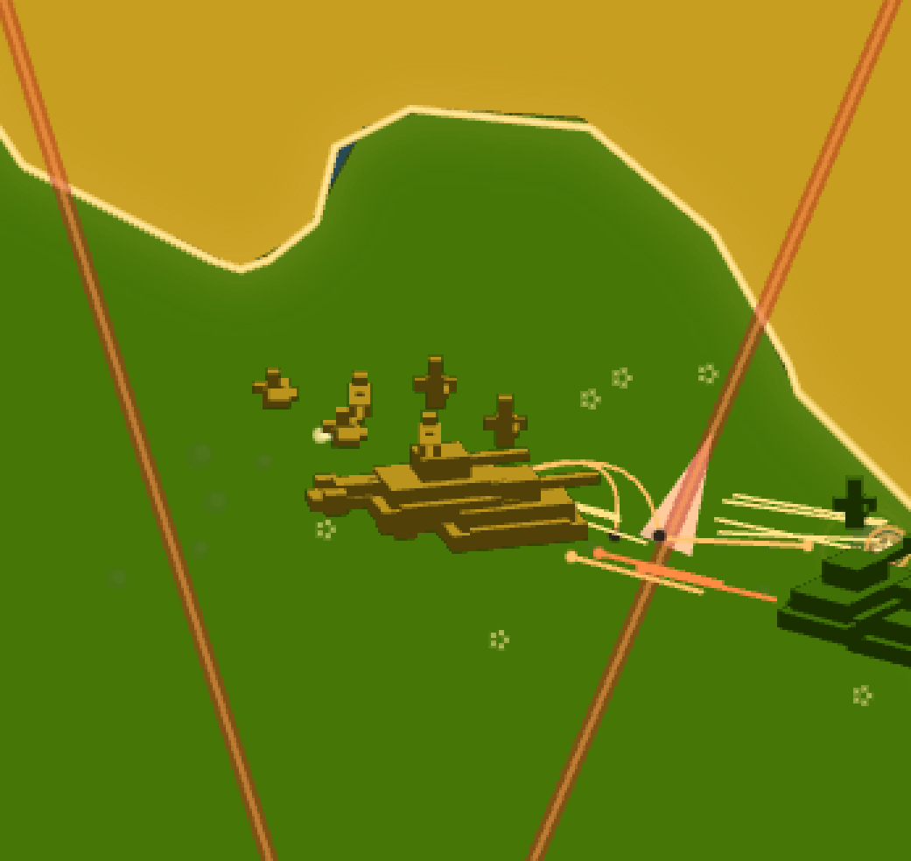

# Crownfall

A real-world grand strategy game that runs in your browser. Pick any country, build bases, buy troops, research tech, and conquer the world on a flat map or a 3D globe.

## Play
- **In your browser:** https://langerweston-web.github.io/crownfall/
- **Windows:** download `Crownfall-World.zip` from [Releases](https://github.com/langerweston-web/crownfall/releases), unzip, and run `Crownfall.exe`. If Windows SmartScreen warns, click **More info → Run anyway**. Needs Edge or Chrome installed.
- **Offline:** download `index.html` and open it in any browser.

## Features
- 202 real countries, 3D globe toggle (V)
- Everyone starts with no army, navy, or bases and a treasury to found the first camp
- A one-year peace period while nations build up
- Drag a Military or Naval Base from the Shop or build bar onto your land
- Base modules (Barracks, Vehicle Depot, Airfield, Hospital, Defenses, Radar, Dry Dock, and more)
- Click a unit to select it (or drag a box), then **right-click** the map to walk there — troops travel continuously, they don't teleport
- A Move button for trackpads; click an enemy to attack
- Every unit type has its own 3D model (riflemen, snipers, medics, tanks, artillery, planes, ships, and more)
- Units always look 3D: WebGL when the GPU allows it, or a shaded Canvas 3D fallback if not (press F3 for a short debug note)
- Firefights: each figure aims, recoils, and fires tracers, shells, rockets, or arcing artillery at a specific enemy
- Target enemy bases; artillery, bombers, and missiles can damage or destroy them
- A leaner, slower tech tree: money and time, research labs, mutually exclusive doctrines
- Simple multiplayer: one Multiplayer button, Host Game or Join Game with a short room code, or Same computer (hot-seat)
- Taxes, tariffs, trade pacts, alliances, puppets, World Congress
- Naval invasions, paratroopers, missiles, military access
- Scenarios: 2026 Modern, 1914, 1939, Random Chaos; Easy / Normal / Hard
- Achievements and stats, autosave

In single player, click a country, then press **Play as** that country. In a multiplayer lobby, click the map to pick your country. Press **H** in game for all controls. Pan with middle-drag, WASD, arrow keys, or the edge of the screen.

