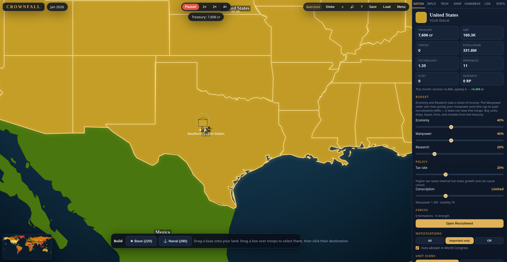

# Crownfall

A real-world grand strategy game that runs in your browser. Pick any country, build bases, buy troops, research tech, and conquer the world on a flat map or a 3D globe.

## Play
- **In your browser:** https://langerweston-web.github.io/crownfall/
- **Windows:** download `Crownfall-World.zip` from [Releases](https://github.com/langerweston-web/crownfall/releases), unzip, and run `Crownfall.exe`. If Windows SmartScreen warns, click **More info → Run anyway**. Needs Edge or Chrome installed.
- **Offline:** download `index.html` and open it in any browser.

## Features
- 202 real countries, 3D globe toggle (V)
- Everyone starts with no army, navy, or bases and a treasury to found the first camp
- A one-year peace period while nations build up
- Drag a Military or Naval Base from the Shop or build bar onto your land
- Base modules (Barracks, Vehicle Depot, Airfield, Hospital, Defenses, Radar, Dry Dock, and more)
- Box-select troops, then click or right-click a destination; path and ETA preview
- Target enemy bases; artillery, bombers, and missiles can damage or destroy them
- Procedural 3D unit models when WebGL is available (2D silhouettes otherwise)
- A leaner, slower tech tree: money and time, research labs, mutually exclusive doctrines
- Online multiplayer (host/join with a room code, PeerJS) plus a local hot-seat mode
- Taxes, tariffs, trade pacts, alliances, puppets, World Congress
- Naval invasions, paratroopers, missiles, military access
- Scenarios: 2026 Modern, 1914, 1939, Random Chaos; Easy / Normal / Hard
- Achievements and stats, autosave

Press **H** in game for all controls.

