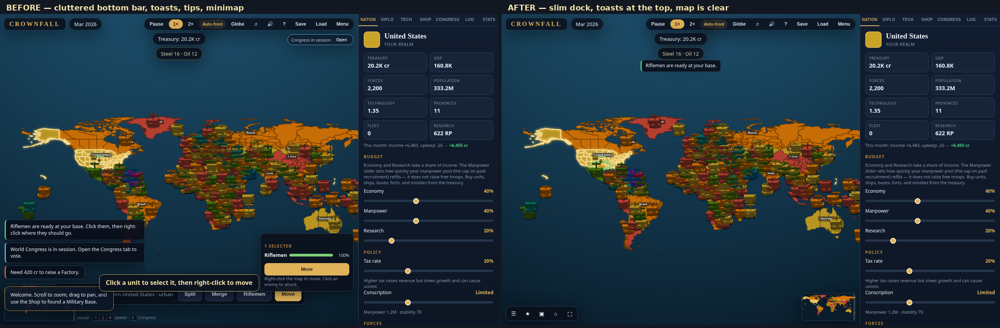
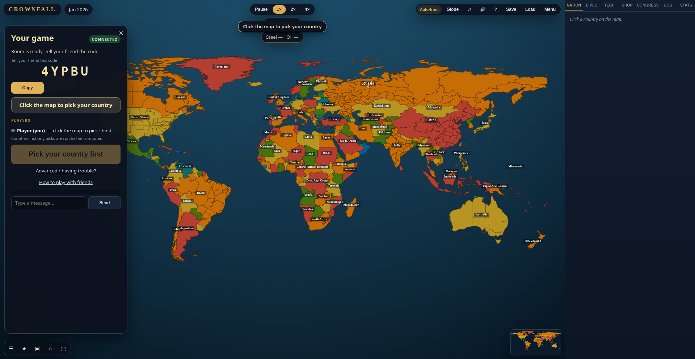
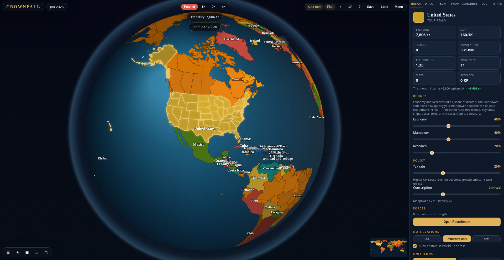

# Crownfall

A real-world grand strategy game that runs in your browser. Pick any country, build bases and cities, buy troops, research tech, and conquer the world on a flat map or a 3D globe.

## Play
- **In your browser:** https://langerweston-web.github.io/crownfall/
- **Windows:** download `Crownfall-World.zip` from [Releases](https://github.com/langerweston-web/crownfall/releases), unzip, and run `Crownfall.exe`. If Windows SmartScreen warns, click **More info → Run anyway**. Needs Edge or Chrome installed.
- **Offline:** download `index.html` and open it in any browser.
- **v1.3 mirrors:** [HTML](https://files.catbox.moe/umtu9i.html) · [Windows zip](https://files.catbox.moe/xkrkma.zip)

## What's new in v1.3
- A full civic building set you buy with money and place by drag-and-drop: Factory, Mine, Oil Well, Power Plant, Farm, Bank, Market, Research Lab, University, Hospital, Bunker, Anti-Air Battery, Coastal Gun, Radar Station, Missile Silo, Airfield, Spy HQ, Propaganda Office, and one Monument per nation. Each has levels 1–3, hit points, upkeep, and a panel to upgrade, repair, demolish, or switch off.
- Steel and oil appear in the HUD. Tanks, planes, and ships spend those resources.
- Every civic building, military/naval base, and base module has its own 3D model. Upgrade levels change the mesh (wings, stacks, height).
- A quality pass on all 3D models: infantry with human proportions, helmets, and held weapons; tanks with tracks, road wheels, turrets, and barrels; planes with wings, tails, and cockpits; ships with hulls, superstructure, and guns. Directional lighting, soft shadows, and outlines on both WebGL and the Canvas 3D fallback. Press F3 if a GPU path fails.
- Camera that actually pans: left-drag empty ground, WASD or arrow keys, middle-drag, right-drag a short distance, edge scroll, and wheel zoom toward the cursor. Shift-drag (or drag starting near your troops) box-selects. Home centers on your country.
- A quieter screen: one slim, collapsed dock at the bottom, short toasts at the top, hints shown once, a small minimap (M, off by default), and a Clean screen toggle (U or Tab) that hides everything but the top resource bar.

## Features
- 202 real countries, 3D globe toggle (V)
- Everyone starts with no army, navy, or bases and a treasury to found the first camp
- A one-year peace period while nations build up
- Drag a Military or Naval Base from the Shop or build bar onto your land
- Base modules (Barracks, Vehicle Depot, Airfield, Hospital, Defenses, Radar, Dry Dock, and more)
- Click a unit to select it, or Shift-drag a box, then **right-click** the map to walk there — troops travel continuously, they don't teleport
- A Move button for trackpads; click an enemy to attack
- Every unit type has its own 3D model (riflemen, snipers, medics, tanks, artillery, planes, ships, and more)
- Units always look 3D: WebGL when the GPU allows it, or a shaded Canvas 3D fallback if not
- Firefights: each figure aims, recoils, and fires tracers, shells, rockets, or arcing artillery at a specific enemy
- Target enemy bases and buildings; artillery, bombers, and missiles can damage or destroy them
- A leaner, slower tech tree: money and time, research labs and universities, mutually exclusive doctrines
- Simple multiplayer: one Multiplayer button, Host Game or Join Game with a short room code, or Same computer (hot-seat)
- Taxes, tariffs, trade pacts, alliances, puppets, World Congress
- Naval invasions, paratroopers, missiles, military access
- Scenarios: 2026 Modern, 1914, 1939, Random Chaos; Easy / Normal / Hard
- Achievements and stats, autosave

In single player, click a country, then press **Play as** that country. In a multiplayer lobby, click the map to pick your country. Press **H** in game for all controls. Pan by dragging empty ground, with WASD or arrow keys, or from the edge of the screen.

